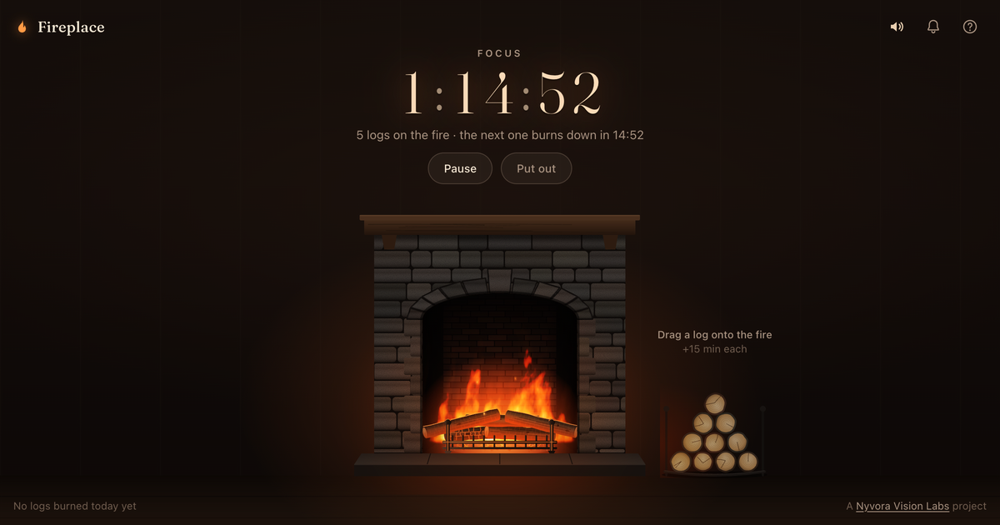

# Fireplace

**Live site: https://nyvora-vision-labs.github.io/fireplace/**

Fireplace is a pomodoro timer you keep alive by feeding a fire. Drag a log from the woodpile onto the fire to start 15 minutes of focus. Every log you add puts another 15 minutes on the clock. Every 15 minutes a log burns down and the fire gets a little smaller. When the last log is gone the fire goes out, and you take a 5-minute break by the embers.



## How it works

- Each log burns for 15 minutes. The hearth holds up to 8 logs, which is two hours.
- At every 15-minute mark the oldest log collapses into the coals in a shower of sparks, the logs above it settle, and the fire burns one step lower.
- In the last few minutes the flames die down. When the fire goes out a 5-minute break starts, and the embers fade with it.
- **Pause** banks the fire and stops the clock. **Put out** ends the session.

Also included:

- Flames drawn live by a WebGL shader over a bed of glowing coals, with sparks and smoke. Logs char, crack and glow as they burn.
- Fire sounds synthesized with the Web Audio API: a low roar, crackles and pops, a thunk when a log lands and a soft bell at each 15-minute mark.
- Optional notifications when the last log is burning and when the fire goes out.
- The timer is based on timestamps, so it keeps going through reloads, sleep and background tabs.
- A tally of the logs you burned today, kept in your browser.
- Installable as an app, and works offline.
- Keyboard shortcuts: <kbd>L</kbd> add a log, <kbd>Space</kbd> pause, <kbd>M</kbd> sound, <kbd>?</kbd> help.

## Run locally

It's a static site with no build step and no dependencies:

```sh
npm start   # serves public/ at http://localhost:8000
npm test    # timer tests (Node 20 or newer)
```

Two URL parameters help when trying things out:

- `?log=0.5` makes each log burn for 30 seconds (it applies when a new fire is lit).
- `?logs=4` starts with four logs on the fire if it isn't already burning.

## Project layout

| Path | What it is |
| --- | --- |
| `public/index.html` | Page markup |
| `public/styles.css` | Layout and styles |
| `public/js/session.js` | The timer, as pure functions over a small state object |
| `public/js/main.js` | Dragging logs, the hearth, lighting, sound and saving |
| `public/js/fire.js` | WebGL shader for the flames and coals |
| `public/js/art.js` | Procedural SVG for the fireplace, the logs and the woodpile |
| `public/js/sparks.js` | Sparks and smoke |
| `public/js/sound.js` | Synthesized fire sounds and chimes |
| `public/sw.js` | Offline support |
| `tests/` | Tests for the timer |

## Deploy

Every push to `main` runs the tests and publishes `public/` to GitHub Pages with [`.github/workflows/deploy.yml`](.github/workflows/deploy.yml).

## Credits

- [Fraunces](https://github.com/undercasetype/Fraunces) by Undercase Type, under the SIL Open Font License ([`public/fonts/OFL.txt`](public/fonts/OFL.txt)).
- The simplex noise in the flame shader is by Ian McEwan and Stefan Gustavson (MIT).

---

A [Nyvora Vision Labs](https://nyvora-vision-labs.github.io/Nyvora-Vision-Labs/) project.
